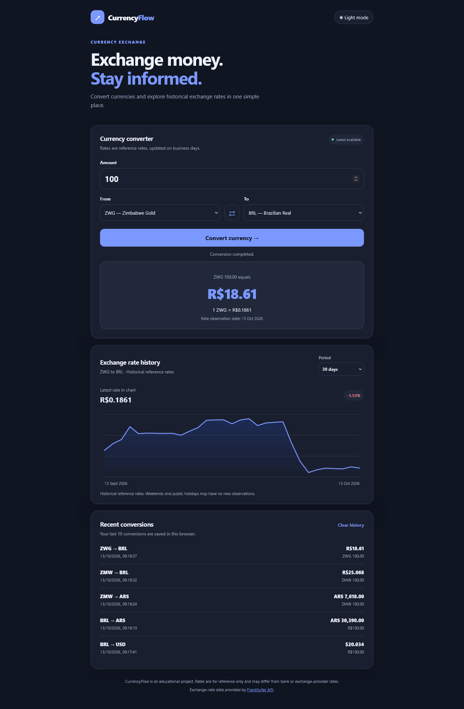
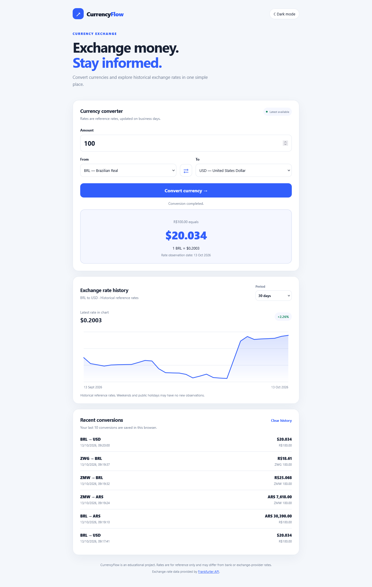

# CurrencyFlow

CurrencyFlow is a clean, responsive currency converter built with HTML, CSS, and vanilla JavaScript. It retrieves supported currencies and exchange-rate data from the Frankfurter API, keeps a local history of recent conversions, and displays historical rates in a chart.

## Features

- **Automatic currency discovery:** loads the currency list from the API.
- **Currency conversion:** converts an amount using the latest available reference rate.
- **Rate observation date:** displays the date associated with the returned exchange rate.
- **Conversion history:** stores the 10 most recent conversions in the browser.
- **Dark mode:** switches between light and dark themes and remembers the selected theme.
- **Historical exchange-rate chart:** visualizes rate changes over 30 days, 90 days, 6 months, or 1 year.
- **Responsive design:** works on desktop and mobile screens.
- **No build tools required:** uses standard browser technologies and does not require npm packages.

## Tech Stack

- HTML5
- CSS3
- Vanilla JavaScript (ES6+)
- Fetch API
- Frankfurter API
- Canvas API
- `localStorage`

## Demo (Dark version)



## Demo (Light version)



## Getting Started

1. Clone or download this repository.
2. Open the project folder in your editor.
3. Open `index.html` in your browser. Alternatively, use the Live Server extension in Visual Studio Code.
4. Make sure you have an internet connection so the application can retrieve currency and exchange-rate data.

No package installation or API key is required.

## Project Structure

```text
currencyflow/
├── index.html
├── style.css
├── script.js
└── README.md
```

## Frankfurter API

CurrencyFlow uses the [Frankfurter API](https://frankfurter.dev/) to retrieve currency metadata, current reference rates, and historical exchange-rate observations.

Frankfurter is a free, open-source exchange-rate API. The public API can be used without an API key. Its rates are reference rates, sourced from central banks and other official institutions. Rates are generally updated on business days, so this API should not be treated as a real-time trading feed.

### API Base URL

The application uses the v2 API:

```text
https://api.frankfurter.dev/v2
```

### 1. Retrieve the Supported Currencies

**Endpoint**

```http
GET https://api.frankfurter.dev/v2/currencies
```

This endpoint returns the currencies supported by the API, including their ISO currency code and full name. CurrencyFlow uses this response to populate the **From** and **To** dropdowns automatically, rather than maintaining a fixed list in the source code.

**Example response**

```json
[
  {
    "iso_code": "EUR",
    "name": "Euro"
  },
  {
    "iso_code": "USD",
    "name": "US Dollar"
  }
]
```

The example above is shortened for documentation. The actual response contains the currencies currently supported by the service.

**How the application uses it**

1. `loadCurrencies()` requests the currency catalogue.
2. The response is filtered to entries with an ISO code and a name.
3. The entries are sorted alphabetically.
4. `populateCurrencySelect()` creates an `<option>` for each currency.
5. BRL and USD are selected by default when they are available in the returned list.

### 2. Retrieve the Latest Available Rate

**Endpoint**

```http
GET https://api.frankfurter.dev/v2/rate/{base}/{quote}
```

Replace `{base}` with the source currency code and `{quote}` with the target currency code.

**Example request**

```http
GET https://api.frankfurter.dev/v2/rate/USD/EUR
```

**Example response**

```json
{
  "date": "2025-01-31",
  "base": "USD",
  "quote": "EUR",
  "rate": 0.96
}
```

The values above are illustrative and must not be interpreted as current exchange rates.

**Response fields**

| Field | Description |
| --- | --- |
| `date` | Date associated with the returned rate. |
| `base` | Source currency code. |
| `quote` | Target currency code. |
| `rate` | Amount of the target currency equivalent to one unit of the source currency. |

For example, if the API returns a rate of `0.96` for USD to EUR, the calculation for USD 100 is:

```text
100 × 0.96 = 96 EUR
```

CurrencyFlow requests this endpoint when a user converts an amount or changes the selected currencies. It multiplies the input amount by the returned rate and formats the result using JavaScript's `Intl.NumberFormat`.

The application also displays the rate's observation date. This date may be earlier than the date on which the user performs the conversion because the API's latest available rate is not necessarily updated every calendar day.

### 3. Retrieve Historical Rates

**Endpoint**

```http
GET https://api.frankfurter.dev/v2/rates?base=USD&quotes=EUR&from=2025-01-01&to=2025-01-31
```

The `base`, `quotes`, `from`, and `to` parameters select the currency pair and date range.

| Parameter | Required | Description |
| --- | --- | --- |
| `base` | Yes | Base/source currency code, such as `USD`. |
| `quotes` | Yes | Target currency code, such as `EUR`. |
| `from` | Yes for this application | Start date in `YYYY-MM-DD` format. |
| `to` | Yes for this application | End date in `YYYY-MM-DD` format. |

**Example response**

```json
[
  {
    "date": "2025-01-02",
    "base": "USD",
    "quote": "EUR",
    "rate": 0.97
  },
  {
    "date": "2025-01-03",
    "base": "USD",
    "quote": "EUR",
    "rate": 0.96
  }
]
```

This is an illustrative shortened response. Actual dates and rates depend on the requested period and the API's available observations.

**How the application uses it**

1. The user selects a chart period: 30 days, 90 days, 6 months, or 1 year.
2. CurrencyFlow calculates the start and end dates.
3. The app requests historical observations for the selected currency pair.
4. The returned data is sorted by date.
5. The Canvas API draws the exchange-rate line chart.
6. The app compares the first and last available rates in the returned series and displays the percentage change.

The percentage shown is calculated from the first and last observations returned for the selected period. It is not a forecast or an investment recommendation.

### API Error Handling

Network requests use `fetch()` and check `response.ok` before processing the response. If the API returns an HTTP error, the browser is offline, or the response cannot be used, CurrencyFlow displays an error message instead of treating the request as successful.

Possible causes include:

- No internet connection.
- Temporary API availability issues.
- An unsupported currency pair.
- No historical observations for the requested pair or period.
- API changes or request limits imposed by the service.

### API Usage Notes and Limitations

- **Reference rates only:** the API rate may differ from rates offered by banks, credit cards, payment services, and exchange offices.
- **Not tick-by-tick data:** rates are not guaranteed to update continuously or in real time.
- **Business-day observations:** weekends and public holidays may not have new observations.
- **Historical data availability:** the available date range depends on the data provided by the API.
- **No API key in this project:** the public endpoints used here do not require an API key.
- **Check the official documentation:** endpoint behavior and data coverage can change. Consult the [Frankfurter documentation](https://frankfurter.dev/) for the latest details.

## Browser Storage

CurrencyFlow uses `localStorage` for two small pieces of client-side state:

- `currencyflow-history`: stores up to 10 recent conversions, including the amount, currencies, rate, result, rate observation date, and conversion timestamp.
- `currencyflow-theme`: stores the selected `light` or `dark` theme.

This data remains in the current browser profile. It is not uploaded to a server or synchronized across devices. Clearing the browser's site data may remove it.

## How the Conversion Works

For a source amount \(A\) and an exchange rate \(R\):

```text
Converted amount = A × R
```

The exchange rate represents the amount of the target currency received for one unit of the source currency, according to the API response.

When both selected currencies are the same, the application uses a rate of `1` and does not need to request a conversion rate.

